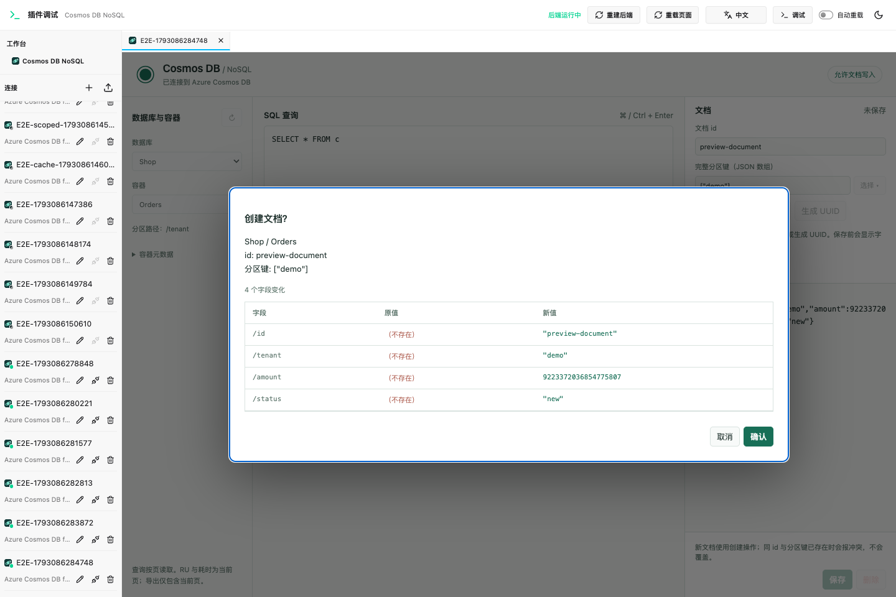
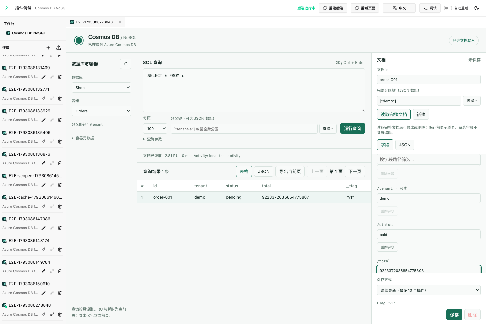
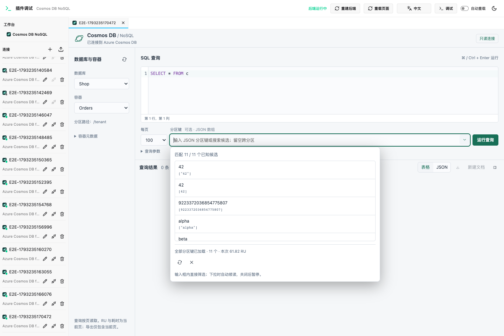

# DBX Cosmos DB NoSQL 插件

免费、MIT 开源的 DBX 独立插件。连接 Azure Cosmos DB **for NoSQL**，无需 VS Code 或商业 JDBC 驱动。

## 当前功能

- DBX 连接表单、Account Key 认证、真实连接测试、数据库与容器浏览。
- Cosmos SQL 查询、参数化查询、可选分区键、逐页读取、上一页缓存。
- CodeMirror 6 SQL / JSON 编辑器：高亮、行号、搜索与匹配数、撤销；JSON 折叠、精确格式化和语法错误行列定位。
- Cosmos SQL 关键字、常用函数、查询参数与已知字段路径补全。文档面板可调整宽度或展开。
- 分区键自动加载全部候选、关键词过滤、暂停与续读；显示加载进度与 RU。
- 保存到容器层的连接，重开时直接进入数据库和容器；兼容原有 Account 连接。
- 当前页 RU、耗时、Activity ID；表格 / JSON 视图；当前页 JSON 导出。
- 按 id + 分区键读取完整文档，新增、替换、删除文档。
- 默认只读；更新和删除使用 ETag，检测并发修改；写操作不自动重试。
- 表格、JSON 编辑和传输保留大整数与小数原文精度。
- 新增时继承当前分区键并生成 UUID；保存 / 删除前预览字段差异；写入后自动刷新上次查询与分区键缓存。
- 字段视图支持筛选、类型保持的编辑与字段增删；默认使用带版本条件的 Patch 局部更新。


## 在 DBX 中安装

兼容目标为 DBX **0.6.49+**、Host API 1.x、sidecar protocol v1。

打开 **DBX → 插件中心 → Marketplace**，搜索 **Cosmos DB NoSQL**，确认发布者为 `fwrq41251`，点击安装。官方商店自动验证安装包签名，无需开启“允许安装未签名开发包”。

正式插件 ID 为 `io.github.fwrq41251.cosmosdb`，当前商店版为 `0.8.0`，支持 macOS ARM64（Apple Silicon）。其他平台暂未提供商店安装包。[上架记录](https://github.com/t8y2/dbx-store/pull/384)。更新或重装前先关闭使用此插件的连接；同一正式插件身份的连接可在安装后重新打开。

新建连接时选择 **Azure Cosmos DB for NoSQL**：

| 字段                | 内容                                                       |
| ------------------- | ---------------------------------------------------------- |
| Account Endpoint    | `https://your-account.documents.azure.com:443/`            |
| Account Key         | Azure Portal → Cosmos DB 账号 → Keys 中的主 / 次密钥       |
| 数据库 ID / 容器 ID | 一起填写后保存为容器连接；均留空则保持 Account 连接。      |
| 只读                | 默认开启；需要编辑时关闭。DBX 自身的只读连接设置仍会生效。 |

Key 由 DBX Secret Store 保存，只有连接生命周期的本地后端收到密钥。工作台不会收到密钥。插件不包含遥测、云中转或 AI 服务。

容器连接在测试连接时直接验证指定容器，打开后自动选中数据库和容器，无需 Account 层的数据库列表请求。插件中的请求会限制在保存的容器内；Account Key 在 Azure 中原有的权限不变。可以为同一账号的不同容器分别保存连接。

打开保存的连接，依次选择数据库、容器并运行 `SELECT * FROM c`。点击结果行仅预览，**读取完整文档** 后才允许编辑，避免用查询投影覆盖完整文档。

分区键以 JSON 数组填写，例如 `["tenant-a"]`、`[42]`、`[null]`；不存在的分区键值用 `[{}]`，层级分区键依次填写所有组件。
参数示例：`[{"name":"@id","value":"order-001"}]`。

## 单文档增删改

写入连接需要可写 Account Key，并关闭连接表单中的“只读”，保存后重新连接。工作台会说明当前只读状态；Azure 只读 Key 本身无法通过关闭插件开关变成可写 Key。

- **新增**：先选择查询分区键，再点击新建，草稿自动生成 UUID 并填入分区字段。可以编辑 id 或点击“生成 UUID”，也可通过文档分区键选择器同步更新草稿中的分区字段。使用 create，不覆盖已有相同 id + 分区键的文档。
- **修改**：读取完整文档后默认进入字段视图，可按字段路径筛选，直接修改字符串、数字和布尔值；数组、null 和空对象使用字段内的 JSON 输入。支持添加与删除字段，也可以切换 JSON 编辑整个草稿。id 和分区键锁定，系统字段不放入可编辑正文。保存前显示原值、新值与增删情况；没有变化时不提交。
- **删除**：先读取完整文档，确认目标与被删除字段后执行；使用读取时的 ETag，若已有并发修改会返回冲突。

正文分区键会在前端和后端校验。写入成功后自动按上次成功查询刷新到第一页；刷新失败会明确说明文档已写入成功，清除旧结果并保留已保存文档，不自动重试写入。新分区键直接补充持久缓存，删除时仅检查目标分区还有没有文档，只有最后一条消失才移除对应候选，无需全容器重新发现。



## 字段编辑与局部更新

已有文档默认使用局部更新：仅将变化转换成 `set` / `remove` Patch 操作，未修改字段不随请求发送。嵌套对象按 JSON Pointer 字段路径更新；数组作为一个整体值，避免数组索引移动导致误修改。输入无效数字或 JSON 时禁用保存，切换视图不会悄悄丢弃错误输入；修正后可继续操作。

Patch 每次最多 10 个操作，超过时会停止并提示；需要时在“保存方式”中明确选择“完整替换文档”。不会自动拆成多次 Patch，也不会自动降级为完整替换。版本检查同时使用 `If-Match` 和基于原 `_etag` 的服务端条件，发生并发变化返回 412，保留本地草稿，不重试写入。

前后端都禁止 Patch 修改 id、分区键及其父子路径、系统字段。局部更新减少提交内容，不保证 RU 一定低于完整替换。



SQL 与 JSON 使用本地打包的 CodeMirror 6，不访问 CDN。SQL 输入时自动显示候选，也可按 `Ctrl + Space` 手动唤起，无需额外按钮。参数候选来自查询参数输入；字段候选只从已读取的完整文档和简单 `SELECT [TOP n] * FROM alias` 根文档查询中学习，按连接、数据库、容器隔离，仅在当前工作区内存中保留，不额外扫描容器。支持根别名、嵌套点路径、简单 `JOIN item IN c.items` 别名；特殊字段名插入方括号访问。候选不代表完整容器结构，复杂子查询与别名作用域暂不提供完整语义分析。

JSON 格式错误会显示行列，点击提示可定位；无效草稿不可保存或切换至字段视图。格式化仅调整空白，保留长整数及小数原文，并支持撤销。读取另一份文档会重置编辑器撤销历史；切换字段 / JSON 视图保留草稿。`⌘ / Ctrl + Enter` 仅在查询区运行查询，避免打断 JSON 草稿。`⌘ / Ctrl + F` 搜索当前编辑器；匹配数量最多统计 10000 项，超出显示 `10000+`。拖动文档区左侧分隔条可调整宽度，聚焦分隔条后左右方向键也可调整；“放大 / 还原”按钮切换文档面板大小。JSON 工具收在“更多”菜单：格式化、折叠嵌套和展开所有层级；折叠嵌套保留根对象和顶层字段，没有嵌套内容时显示不可用原因。完整文档读出后自动收起定位表单，并在同一工作区记住所选的字段 / JSON 视图。

SQL 语法错误、分区键不匹配、跨分区管线限制、索引不足、只读凭据、防火墙和并发冲突会显示对应中文说明；服务有提供 SQL 位置时会提示字符位置。不直接展示服务端原始错误中的 SQL 字面值或文档内容。无法分类的错误保留 HTTP 状态和通用说明。

## 分区键选择

查询和文档区域的分区键输入框旁均有 **选择** 按钮。打开后输入关键词，即可过滤已知候选；点击候选填入对应输入框，再运行查询或读取文档。字符串、数字、null 和大整数会保留原始类型与精度，也可以继续手动填写 JSON 数组。

打开选择器先读取本地持久缓存，已有完整缓存时不发起分区键发现查询。首次没有缓存时自动加载，候选一到即可筛选和选择；关键词过滤在本地进行。查询结果中包含完整分区字段时，也会补充当前工作台的候选。

0.4.0 使用索引跳读代替 DISTINCT：在每个物理分区内，通过 `TOP 1`、`ORDER BY` 和严格大于上个值的条件跳过重复记录。字符串和数字分别枚举，再检查布尔值、null 和未定义值。每次 RPC 最多执行一次数据查询；后续请求复用分区元数据。当前支持单路径分区键，层级分区键或缺少所需索引时显示错误，保留手动输入，不自动退回文档扫描。

发现的候选、完成状态和续读游标按 Account Endpoint、连接 ID、数据库和容器隔离，保存到操作系统的用户缓存目录 `dbx-plugin-cosmosdb/partition-keys-v1/`。文件仅当前系统用户可读写，不保存密钥或文档正文。重开工作台或重连后可复用；界面标明缓存时间和本次 RU。缓存是历史快照，不会因时间自动全量刷新；新增或删除分区键后点击 **刷新列表** 重新发现。上次查询所选分区键仍只保留在工作台内存中。

关闭选择器或暂停会停止后续请求，重新打开可继续；已发送的一次请求仍可能返回。429 会等待后重试。每轮自动加载达到 2000 RU 后暂停，保留候选和进度；需要时可继续。缓存不可用时显示提示。加载尚未完成时，关键词仅匹配已知候选；并发数据变化、容器重建或物理分区拆分可能需要刷新。



## 开发与验证

需要 Node.js 22+、Go 1.22+。最终用户安装 `.dbxp` 后无需这些运行时。

普通用户从商店安装即可。从源码构建的安装包生成在 `dist/`；源码仓库 Release 提供的是未签名审核候选包，仅用于开发验证。手动安装开发包时，在 DBX → 插件中心 → 设置 → 第三方与开发者选项启用“允许安装未签名开发包”，再选择 `.dbxp` 安装。正式发布流程见 [发布与商店审核](docs/RELEASING.md)。

```bash
npm ci
npm run build
npm test
cd backend
go test -race ./...
go vet ./...
cd ..
npm run test:browser
npm run package
```

`npm run dev` 启动官方 DBX 浏览器开发宿主。`.dbx-dev/` 是独立的本地开发配置，不读取 DBX 用户数据库；其中的凭据是开发宿主保存的明文，请仅使用测试账号。

浏览器测试通过本地模拟 Cosmos HTTP 服务、真实 Go sidecar 和 DBX 官方开发宿主验证连接、查询、分页、只读、精度、ETag 冲突和文档增删改。测试用默认端口 5191、18081。Mac 默认使用已安装的 Chrome；CI 安装 Playwright Chromium。

可选真实 Azure 验证：`python3 scripts/validate-live-cud.py --resource-group <group> --account <account> --database <database> --package <native.dbxp> --run`。脚本仅在本次新建的临时容器操作假数据，结束后删除容器并确认不存在；可写 Key 仅放在内存，不写入 DBX。Serverless 使用按请求计费；预配账号会临时分配 400 RU/s，请仅在开发账号显式运行。

## 首版边界

- 已在本机 DBX 0.6.49 安装，并以真实 dev 账号的只读 Key 验证查询及点读。0.5.0 已在单独创建并清理的 Azure 临时容器验证真实单文档增删改、409 / 412 冲突与只读拦截。
- 当前使用 REST gateway，不实现 Azure SDK 的跨物理分区查询计划 / 合并管线。需要该管线的查询形态可能失败，可指定分区键；不宣称完整 SDK 查询兼容。
- Account Key 认证；暂不支持 Entra ID、SSH / DBX 代理路由、自动区域切换或吞吐量 / 索引修改。
- 分区键加载会处理 429 等待重试；查询及文档操作不自动重试。请求超时后应先重新读取，确认写入是否已完成。
- 查询按页读取；导出仅当前页且上限 1 MiB。单服务响应上限 6 MiB；过大时减小每页数量。
- 写入后仅刷新上次成功查询的第一页；如失败会清空旧结果并提示手动重跑。批量修改 / 删除仍未实现。
- 宿主关闭标签页或重载插件会丢失内存中的草稿；插件内切换容器、查询或文档会提示未保存修改。

## 结构与许可

`backend/`：Go sidecar、Cosmos REST 客户端与测试。

`src/`：工作台源码；`ui/index.html` 为打包后的独立沙箱入口。

`manifest.json` / `dbx-plugin.toml`：DBX 插件契约与打包配置。

`tests/`：本地模拟服务及模型 / 浏览器测试。

本项目采用 MIT。固定引入的 DBX Go SDK 来自 `t8y2/dbx` 的 v0.6.49，采用 Apache-2.0，副本、许可证与版本说明位于 `backend/third_party/dbx-plugin-sdk/`。前端使用 MIT 许可的 lossless-json、CodeMirror 6 及相关语言和编辑扩展，全部生产依赖的许可证随包分发。

协议参考：[DBX 插件开发](https://dbxio.com/en/docs/plugin-development)、[Cosmos REST 认证](https://learn.microsoft.com/en-us/rest/api/cosmos-db/access-control-on-cosmosdb-resources)、[查询](https://learn.microsoft.com/en-us/rest/api/cosmos-db/query-documents)、[文档替换](https://learn.microsoft.com/en-us/rest/api/cosmos-db/replace-a-document)。
