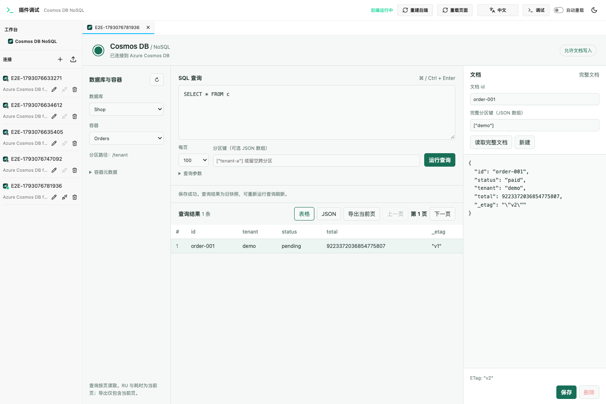

# DBX Cosmos DB NoSQL 插件

免费、MIT 开源的 DBX 独立插件。连接 Azure Cosmos DB **for NoSQL**，无需 VS Code 或商业 JDBC 驱动。

## 当前功能

- DBX 连接表单、Account Key 认证、真实连接测试、数据库与容器浏览。
- Cosmos SQL 查询、参数化查询、可选分区键、逐页读取、上一页缓存。
- 当前页 RU、耗时、Activity ID；表格 / JSON 视图；当前页 JSON 导出。
- 按 id + 分区键读取完整文档，新增、替换、删除文档。
- 默认只读；更新和删除使用 ETag，检测并发修改；写操作不自动重试。
- 表格、JSON 编辑和传输保留大整数与小数原文精度。



## 在 DBX 中安装

兼容目标为 DBX **0.6.49+**、Host API 1.x、sidecar protocol v1。

从源码运行下方构建命令后，安装包生成在 `dist/`；例如 Mac ARM64 对应 `io.local.cosmosdb-0.1.0-darwin-arm64.dbxp`。
这是本地构建的未签名开发包。打开 DBX → 插件中心 → 设置 → 第三方与开发者选项，启用“允许安装未签名开发包”，然后选择 `.dbxp` 安装。它尚未上架官方商店。

新建连接时选择 **Azure Cosmos DB for NoSQL**：

| 字段             | 内容                                                       |
| ---------------- | ---------------------------------------------------------- |
| Account Endpoint | `https://your-account.documents.azure.com:443/`            |
| Account Key      | Azure Portal → Cosmos DB 账号 → Keys 中的主 / 次密钥       |
| 只读             | 默认开启；需要编辑时关闭。DBX 自身的只读连接设置仍会生效。 |

Key 由 DBX Secret Store 保存，只有连接生命周期的本地后端收到密钥。工作台不会收到密钥。插件不包含遥测、云中转或 AI 服务。

打开保存的连接，依次选择数据库、容器并运行 `SELECT * FROM c`。点击结果行仅预览，**读取完整文档** 后才允许编辑，避免用查询投影覆盖完整文档。

分区键以 JSON 数组填写，例如 `["tenant-a"]`、`[42]`、`[null]`；不存在的分区键值用 `[{}]`，层级分区键依次填写所有组件。
参数示例：`[{"name":"@id","value":"order-001"}]`。

## 开发与验证

需要 Node.js 22+、Go 1.22+。最终用户安装 `.dbxp` 后无需这些运行时。

```bash
npm ci
npm run build
npm test
cd backend
go test -race ./...
go vet ./...
cd ..
npm run test:browser
npm run package
```

`npm run dev` 启动官方 DBX 浏览器开发宿主。`.dbx-dev/` 是独立的本地开发配置，不读取 DBX 用户数据库；其中的凭据是开发宿主保存的明文，请仅使用测试账号。

浏览器测试通过本地模拟 Cosmos HTTP 服务、真实 Go sidecar 和 DBX 官方开发宿主验证连接、查询、分页、只读、精度、ETag 冲突和文档增删改。测试用默认端口 5191、18081。Mac 默认使用已安装的 Chrome；CI 安装 Playwright Chromium。

## 首版边界

- 已在本机 DBX 0.6.49 安装，并以真实 dev 账号的只读 Key 验证数据库 / 容器列表、指定分区查询及文档点读。云端写操作尚未验证。
- 当前使用 REST gateway，不实现 Azure SDK 的跨物理分区查询计划 / 合并管线。需要该管线的查询形态可能失败，可指定分区键；不宣称完整 SDK 查询兼容。
- Account Key 认证；暂不支持 Entra ID、SSH / DBX 代理路由、自动区域切换或吞吐量 / 索引修改。
- 不自动处理 429 或重试写入；请求超时后应先重新读取，确认写入是否已完成。
- 查询按页读取；导出仅当前页且上限 1 MiB。单服务响应上限 6 MiB；过大时减小每页数量。
- 文档修改后，查询表格仍是旧快照，需重新运行查询刷新。
- 宿主关闭标签页或重载插件会丢失内存中的草稿；插件内切换容器、查询或文档会提示未保存修改。

## 结构与许可

`backend/`：Go sidecar、Cosmos REST 客户端与测试。

`src/`：工作台源码；`ui/index.html` 为打包后的独立沙箱入口。

`manifest.json` / `dbx-plugin.toml`：DBX 插件契约与打包配置。

`tests/`：本地模拟服务及模型 / 浏览器测试。

本项目采用 MIT。固定引入的 DBX Go SDK 来自 `t8y2/dbx` 的 v0.6.49，采用 Apache-2.0，副本、许可证与版本说明位于 `backend/third_party/dbx-plugin-sdk/`。前端使用 MIT 许可的 lossless-json，许可证随包分发。

协议参考：[DBX 插件开发](https://dbxio.com/en/docs/plugin-development)、[Cosmos REST 认证](https://learn.microsoft.com/en-us/rest/api/cosmos-db/access-control-on-cosmosdb-resources)、[查询](https://learn.microsoft.com/en-us/rest/api/cosmos-db/query-documents)、[文档替换](https://learn.microsoft.com/en-us/rest/api/cosmos-db/replace-a-document)。
